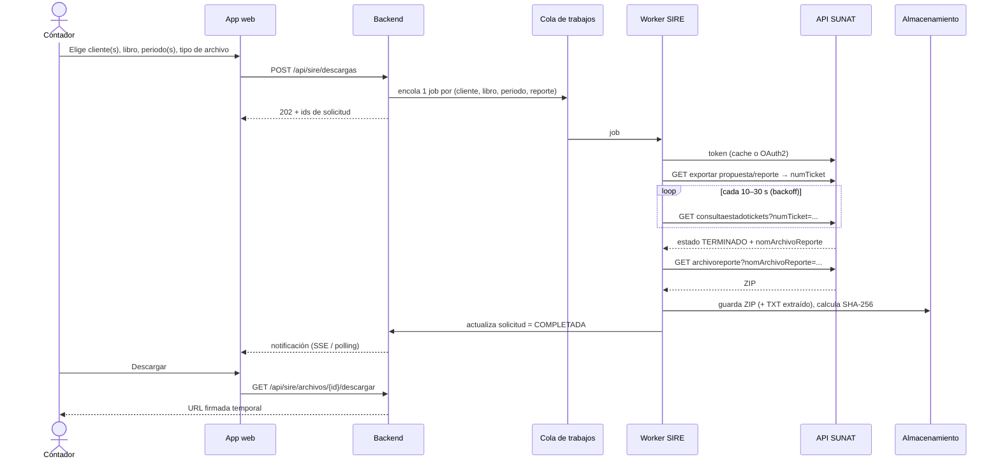
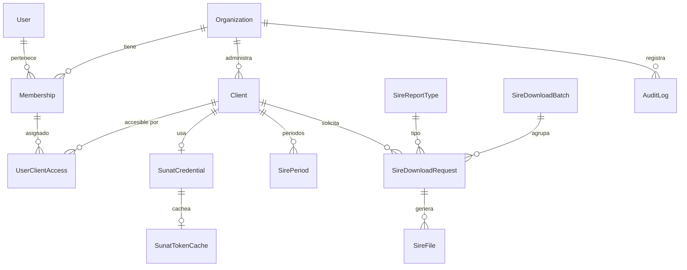

# Módulo 1 — Descarga de documentos SIRE (SUNAT)

Esquema funcional y técnico de la **primera funcionalidad** del sistema contable:
que un **contador** o **administrador** descargue, para **cada uno de sus clientes**
(contribuyentes con RUC), los documentos consultables del **SIRE** (Sistema
Integrado de Registros Electrónicos) a través de la API de SUNAT.

> Las rutas y parámetros de la API están tomados del *Manual de Servicios Web
> API SIRE* publicado por SUNAT. SUNAT versiona ese manual con frecuencia:
> antes de implementar, validar cada endpoint contra la versión vigente y
> centralizar las URLs en configuración (ver §6.4).

---

## 1. Alcance

### Incluido en el Módulo 1
| Libro | Código | Documentos descargables |
|---|---|---|
| **RVIE** – Registro de Ventas e Ingresos Electrónico | `140000` | Propuesta SUNAT, preliminar registrado, comprobantes no incluidos, resumen, inconsistencias |
| **RCE** – Registro de Compras Electrónico | `080000` | Propuesta SUNAT, preliminar registrado, comprobantes no incluidos / excluidos, resumen, inconsistencias |

Formato de salida de SUNAT: archivo **ZIP** que contiene **TXT** (delimitado por `|`)
o **XLS/CSV**, según el `codTipoArchivo` solicitado.

### Fuera de alcance (fases siguientes)
- Envío/aceptación de la propuesta, reemplazo o ajustes posteriores (escritura en SIRE).
- Parseo completo e importación a la contabilidad (asientos, Libro Diario, etc.).
- Consulta de validez de CPE, consulta RUC, buzón SOL, PLE.

---

## 2. Actores y modelo multi-cliente

```
Estudio contable (Organización / tenant)
├── Usuarios
│   ├── ADMIN       → gestiona usuarios, clientes, credenciales y facturación
│   ├── CONTADOR    → descarga y consulta documentos de los clientes asignados
│   └── ASISTENTE   → solo consulta/descarga archivos ya obtenidos (opcional)
└── Clientes (contribuyentes)
    ├── RUC 20xxxxxxxxx – Empresa A  ── credenciales SUNAT propias
    ├── RUC 10xxxxxxxxx – Persona B  ── credenciales SUNAT propias
    └── ...
```

Reglas clave:
1. **Todo dato pertenece a una Organización** (`organizationId` en cada tabla) → aislamiento entre estudios.
2. **Cada cliente tiene sus propias credenciales SUNAT.** La API SIRE se autentica *por RUC*, no por contador.
3. Un usuario solo ve los clientes que tiene **asignados** (`UserClientAccess`); el ADMIN ve todos.
4. Un mismo contador puede pertenecer a más de una organización (útil para contadores independientes que trabajan con varios estudios).

---

## 3. Credenciales SUNAT que debe registrar cada cliente

Para consumir la API SIRE por cada RUC se necesitan **4 datos**:

| Dato | Origen | Notas |
|---|---|---|
| `RUC` | Cliente | 11 dígitos, validar dígito verificador |
| `Usuario SOL` | Cliente | Usuario principal o secundario con perfil SIRE |
| `Clave SOL` | Cliente | **Secreto** – cifrar |
| `client_id` | SUNAT Operaciones en Línea → *Credenciales de API SUNAT* | Lo genera el contribuyente (o su contador con su clave SOL) |
| `client_secret` | Ídem | **Secreto** – cifrar |

Recomendación operativa: pedir al cliente que cree un **usuario SOL secundario**
con perfil solo para SIRE y generar con él las credenciales API. Así el estudio
no maneja la clave del usuario principal y el cliente puede revocar acceso.

En la UI: asistente "Conectar cliente con SUNAT" con botón **Probar conexión**
(solicita un token y lista los periodos; si responde, marca la credencial como `VALIDA`).

---

## 4. Flujo de la API SIRE

### 4.1 Autenticación (OAuth2 – password grant)

```
POST https://api-seguridad.sunat.gob.pe/v1/clientessol/{client_id}/oauth2/token/
Content-Type: application/x-www-form-urlencoded

grant_type=password
scope=https://api-sire.sunat.gob.pe
client_id={client_id}
client_secret={client_secret}
username={RUC}{USUARIO_SOL}        ← concatenados, p.ej. 20123456789MIUSUARIO
password={CLAVE_SOL}
```
Respuesta: `access_token` (JWT) con `expires_in` ≈ 3600 s.
→ **Cachear el token por cliente** hasta ~5 min antes de expirar; no pedir uno por request.

### 4.2 Descarga asíncrona por ticket

SUNAT no devuelve el archivo directamente: genera un **ticket** y el archivo se
prepara en segundo plano.



### 4.3 Endpoints SIRE usados en el Módulo 1

Base: `https://api-sire.sunat.gob.pe/v1/contribuyente/migeigv/libros`

| # | Acción | Método y ruta (relativa a la base) |
|---|---|---|
| 1 | Listar ejercicios y periodos disponibles | `GET /rvierce/padron/web/omisos/{codLibro}/periodos` |
| 2 | Exportar propuesta **RVIE** | `GET /rvie/propuesta/web/propuesta/{perTributario}/exportapropuesta?codTipoArchivo={0\|1}` |
| 3 | Exportar propuesta **RCE** | `GET /rce/propuesta/web/propuesta/{perTributario}/exportacioncomprobantepropuesta?codTipoArchivo={0\|1}&codOrigenEnvio=2` |
| 4 | Consultar estado de tickets | `GET /rvierce/gestionprocesosmasivos/web/masivo/consultaestadotickets?perIni=&perFin=&page=1&perPage=20&numTicket=` |
| 5 | Descargar archivo del ticket | `GET /rvierce/gestionprocesosmasivos/web/masivo/archivoreporte?nomArchivoReporte=&codTipoArchivoReporte=&perTributario=&codProceso=&numTicket=&codLibro=` |
| 6 | Otros reportes (preliminar, no incluidos, inconsistencias, resumen) | Endpoints propios de cada libro en el manual; mismo patrón *ticket → estado → archivo* |

- `perTributario` = `YYYYMM` (ej. `202609`).
- `codTipoArchivo`: `0` = TXT, `1` = XLS/CSV.
- Header: `Authorization: Bearer {access_token}`.

Estos endpoints se modelan en una tabla de catálogo (`SireReportType`) para poder
agregar o corregir reportes sin cambiar código.

---

## 5. Modelo de datos

Borrador Prisma completo en [`schema.draft.prisma`](./schema.draft.prisma).



### 5.1 Entidades

| Entidad | Propósito | Campos principales |
|---|---|---|
| `Organization` | Estudio contable / empresa usuaria (tenant) | `ruc`, `razonSocial`, `plan` |
| `User` | Persona que inicia sesión | `email`, `passwordHash`, `mfaEnabled` |
| `Membership` | Usuario dentro de una organización + rol | `role` (`ADMIN`/`CONTADOR`/`ASISTENTE`) |
| `Client` | Contribuyente atendido | `ruc`, `razonSocial`, `regimenTributario`, `estadoContribuyente`, `condicionDomicilio`, `afectoSire`, `activo` |
| `UserClientAccess` | Qué clientes ve cada miembro | `membershipId`, `clientId`, `permission` (`READ`/`DOWNLOAD`/`MANAGE`) |
| `SunatCredential` | Credenciales API por cliente (**cifradas**) | `solUser`, `solPasswordEnc`, `apiClientId`, `apiClientSecretEnc`, `status`, `lastValidatedAt`, `lastError` |
| `SunatTokenCache` | Último token emitido (cifrado) | `accessTokenEnc`, `expiresAt` |
| `SirePeriod` | Periodos devueltos por SUNAT para cada libro | `codLibro`, `perTributario`, `estado` (ej. *pendiente*, *generado*) |
| `SireReportType` | Catálogo de reportes descargables | `code`, `codLibro`, `nombre`, `endpointTemplate`, `formatos` |
| `SireDownloadBatch` | Solicitud masiva (varios clientes/periodos de una vez) | `requestedById`, `total`, `completados`, `fallidos` |
| `SireDownloadRequest` | 1 descarga = (cliente, libro, reporte, periodo, formato) | `status`, `numTicket`, `attempts`, `nextPollAt`, `errorCode`, `errorMessage` |
| `SireFile` | Archivo obtenido | `storageKey`, `fileName`, `mimeType`, `sizeBytes`, `sha256`, `recordCount`, `version` |
| `AuditLog` | Trazabilidad | `actorId`, `action`, `entity`, `entityId`, `ip`, `metadata` |

### 5.2 Estados de una descarga

```
PENDIENTE ──► SOLICITANDO_TICKET ──► EN_PROCESO_SUNAT ──► DESCARGANDO ──► COMPLETADA
     │                │                     │                  │
     └────────────────┴──────► ERROR ◄──────┴──────────────────┘
                                 │  (reintento con backoff si es transitorio)
                                 └──► FALLIDA (tras N intentos o error definitivo)
```

Errores definitivos (no reintentar): credenciales inválidas (`401` en token),
periodo no habilitado, cliente no afecto a SIRE.
Errores transitorios (reintentar): `5xx`, timeout, límite de peticiones (`429`).

### 5.3 Deduplicación y versionado
- Índice único lógico: `(clientId, reportTypeId, perTributario, formato)` para
  descargas **activas** → si ya hay una en curso, se reutiliza.
- Cada nueva descarga completada crea un `SireFile` con `version + 1`; se marca
  la última como `isLatest`. La propuesta SUNAT cambia en el tiempo (nuevos CPE
  emitidos por proveedores), por eso se conservan las versiones.
- `sha256` permite detectar si la nueva versión es idéntica y evitar duplicados.

---

## 6. Arquitectura técnica

### 6.1 Componentes
| Capa | Propuesta | Motivo |
|---|---|---|
| Web + API | **Next.js** (App Router, ya presente en el repo) | Reutiliza stack actual |
| Auth | NextAuth/Auth.js + **MFA (TOTP)** para ADMIN/CONTADOR | Manejan secretos tributarios de terceros |
| Base de datos | **PostgreSQL** (no SQLite) | Concurrencia de workers, multi-tenant, RLS opcional |
| Cola de trabajos | **BullMQ + Redis** o **pg-boss** (sobre Postgres) | La descarga es asíncrona y requiere polling/reintentos |
| Worker | Proceso Node separado (`/workers/sire.ts`) | Las funciones serverless no sirven para polling largo |
| Archivos | **S3 / Cloudflare R2 / GCS** con cifrado en reposo y URLs firmadas | Los ZIP/TXT pueden ser grandes |
| Secretos | Cifrado **AES-256-GCM** con *envelope encryption* (clave maestra en KMS o variable segura) | Clave SOL y client_secret |

### 6.2 Estructura de código sugerida
```
src/
  modules/sire/
    sunat-auth.ts          # obtiene/cachea token por cliente
    sire-client.ts         # wrapper HTTP de los endpoints SIRE (timeouts, retries)
    sire-endpoints.ts      # catálogo de rutas (configurable)
    download-service.ts    # crea solicitudes, deduplica, encola
    file-storage.ts        # subida/descarga a S3, URLs firmadas
    parsers/               # (fase 2) lectura de TXT RVIE/RCE
  lib/crypto.ts            # encrypt/decrypt de secretos
  app/api/clients/...      # CRUD clientes + credenciales + probar conexión
  app/api/sire/...         # periodos, descargas, archivos
workers/
  sire-worker.ts           # consume la cola: ticket → estado → archivo
```

### 6.3 API interna (REST)
| Método | Ruta | Rol mínimo | Descripción |
|---|---|---|---|
| `GET` | `/api/clients` | ASISTENTE | Clientes asignados al usuario |
| `POST` | `/api/clients` | ADMIN | Alta de cliente (valida RUC) |
| `PUT` | `/api/clients/{id}/sunat-credential` | ADMIN | Registra/actualiza credenciales |
| `POST` | `/api/clients/{id}/sunat-credential/test` | CONTADOR | Prueba conexión con SUNAT |
| `GET` | `/api/clients/{id}/sire/periodos?libro=140000` | CONTADOR | Periodos disponibles (refresca de SUNAT) |
| `POST` | `/api/sire/descargas` | CONTADOR | Crea solicitud(es): `{ clientIds[], libro, reportes[], periodos[], formato }` |
| `GET` | `/api/sire/descargas?clientId=&estado=&periodo=` | ASISTENTE | Historial y estado |
| `POST` | `/api/sire/descargas/{id}/reintentar` | CONTADOR | Reintento manual |
| `GET` | `/api/sire/archivos/{id}/descargar` | ASISTENTE | URL firmada (5 min) + registro en auditoría |
| `GET` | `/api/sire/archivos/zip?ids=` | CONTADOR | Paquete de varios archivos |

Toda ruta valida: sesión → organización activa → rol → acceso al cliente.

### 6.4 Configuración (variables de entorno)
```
DATABASE_URL=postgresql://...
REDIS_URL=redis://...
SUNAT_AUTH_URL=https://api-seguridad.sunat.gob.pe/v1/clientessol/{client_id}/oauth2/token/
SUNAT_SIRE_BASE_URL=https://api-sire.sunat.gob.pe/v1/contribuyente/migeigv/libros
SUNAT_SIRE_SCOPE=https://api-sire.sunat.gob.pe
SIRE_POLL_INTERVAL_MS=15000
SIRE_POLL_MAX_ATTEMPTS=40
SIRE_MAX_CONCURRENCY_PER_RUC=2
ENCRYPTION_MASTER_KEY=...           # o referencia a KMS
STORAGE_BUCKET=...
```

---

## 7. Pantallas (UX)

1. **Clientes** – tabla con RUC, razón social, régimen, estado de credencial
   (🟢 válida / 🟡 sin probar / 🔴 error), última descarga.
2. **Ficha de cliente → pestaña SUNAT** – registrar credenciales, probar conexión,
   guía paso a paso para generar `client_id`/`client_secret` en SOL.
3. **Descargar SIRE** – selector de cliente(s) (múltiple), libro (RVIE/RCE),
   reportes, rango de periodos, formato (TXT/XLS). Botón *Descargar*.
4. **Centro de descargas** – lista en tiempo real con estado, progreso,
   botón descargar / reintentar, filtro por cliente y periodo.
5. **Repositorio de archivos** – vista por cliente → año → mes → libro, con versiones.
6. **Auditoría** (ADMIN) – quién descargó qué y cuándo.

---

## 8. Seguridad y cumplimiento

- **Cifrado** de `Clave SOL`, `client_secret` y tokens; nunca devolverlos al
  frontend (solo `••••` + fecha de actualización).
- **Nunca registrar secretos en logs**; sanitizar requests/responses de SUNAT.
- Acceso por **rol + asignación de cliente**; consultas siempre filtradas por `organizationId`.
- **MFA** obligatorio para ADMIN y CONTADOR.
- **Auditoría** de: alta/edición de credenciales, prueba de conexión, cada descarga y cada acceso a archivo.
- **Ley N.° 29733** (Protección de Datos Personales) y su reglamento: los
  registros contienen datos de terceros (clientes/proveedores de los clientes).
  Incluir consentimiento/contrato de encargo con el cliente, política de
  retención y eliminación de archivos.
- Rotación de la clave maestra y revocación inmediata de credenciales si el cliente lo solicita.
- Límite de concurrencia por RUC y backoff para no saturar la API de SUNAT.

---

## 9. Plan de implementación sugerido

| Fase | Entregable |
|---|---|
| **0** | Migrar a PostgreSQL; módulo de organizaciones, roles y membresías |
| **1** | CRUD de clientes + validación de RUC + credenciales cifradas + "Probar conexión" |
| **2** | `sunat-auth` + `sire-client` + listado de periodos por cliente |
| **3** | Cola + worker: propuesta RVIE y RCE (ticket → estado → archivo) + almacenamiento |
| **4** | Centro de descargas, historial, versiones, descargas masivas (varios clientes/periodos) |
| **5** | Reportes adicionales (preliminar, no incluidos, inconsistencias, resumen) + auditoría |
| **6** | (Siguiente módulo) Parseo de TXT RVIE/RCE e importación a la contabilidad |

### Criterios de aceptación del Módulo 1
- [ ] Un ADMIN registra un cliente con credenciales y la prueba de conexión resulta exitosa.
- [ ] Un CONTADOR asignado ve los periodos disponibles de RVIE y RCE de ese cliente.
- [ ] Puede solicitar la propuesta de uno o varios periodos y clientes en una sola acción.
- [ ] El sistema obtiene el archivo vía ticket sin intervención y notifica al terminar.
- [ ] El archivo queda versionado y descargable; cada descarga queda auditada.
- [ ] Un CONTADOR **no** asignado a un cliente no puede ver ni descargar sus archivos.
- [ ] Ningún secreto aparece en logs, respuestas de API ni en el frontend.

---

## 10. Preguntas abiertas

1. ¿Se ofrecerá como SaaS para varios estudios (multi-tenant) o como instalación para un solo estudio?
2. ¿Quién genera las credenciales API: el cliente o el estudio con la clave SOL del cliente?
3. ¿Tiempo de retención de archivos descargados?
4. ¿Se requieren descargas programadas (p. ej., propuesta automática el día X de cada mes)?
5. ¿Proveedor de nube preferido (AWS / GCP / Azure / VPS)?
